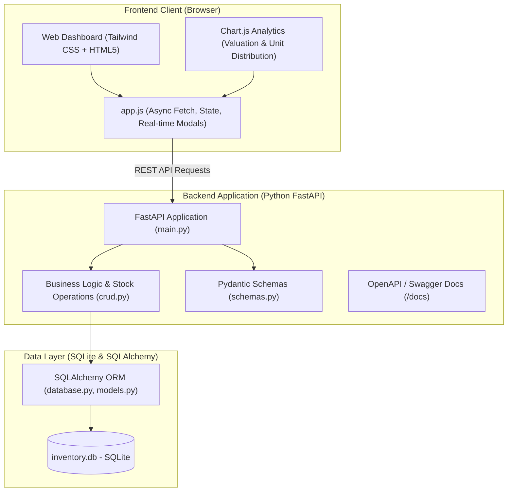

# StockMaster — Inventory and Stock Management System

A production-ready **Inventory and Stock Management System** designed for small businesses to manage product catalogs, track stock levels in real time, configure automated low-stock threshold alerts, audit inventory movements, and inspect financial valuation analytics.

---

## 🌟 Key Features

| Feature | Description |
| :--- | :--- |
| **Product & Stock Management** | Full catalog control: unique SKU, name, description, category, unit selling price, cost price, stock units, and threshold settings. |
| **Add / Update / Delete Inventory** | Dynamic interactive modals with input validation, duplicate SKU prevention, and deletion cascades. |
| **Low Stock & Out of Stock Alerts** | Automated detection when stock falls below `min_threshold`. Displays animated warning indicators, top notification bell count, and a quick-restock banner. |
| **Stock In / Out / Audit Control** | Quick adjustment mechanism: **Restock (IN)**, **Dispatch (OUT)**, and **Physical Recount (ADJUSTMENT)** with strict over-dispatch prevention. |
| **Audit Trail & Movement History** | Every stock change logs previous balance, delta, resulting balance, movement timestamp, and operator reason. |
| **RESTful Backend APIs** | Built on **FastAPI** with automatic interactive OpenAPI / Swagger documentation (`/docs`) and ReDoc (`/redoc`). |
| **Database Integration** | **SQLAlchemy ORM** + **SQLite** with automated table provisioning and initial sample data seeding. |
| **Interactive Dashboard** | Single-page modern dashboard with KPI cards, live search, category filtering, stock health bars, and Chart.js analytics. |

---

## 🏗️ Architecture & Tech Stack



- **Backend**: Python 3.9+, FastAPI, Uvicorn, Pydantic v2
- **Database / ORM**: SQLite, SQLAlchemy 2.0+
- **Frontend**: HTML5, Tailwind CSS (CDN), Font Awesome 6, Chart.js
- **Templates**: Jinja2

---

## 🚀 Getting Started

### 1. Prerequisites
Ensure you have Python 3.9 or newer installed on your system.

### 2. Install Dependencies
Open your terminal inside the project directory (`tt_project`) and run:
```bash
pip install -r requirements.txt
```

### 3. Launch the Application
Start the system using the unified runner:
```bash
python run.py
```
*(Alternatively, you can run directly via uvicorn: `uvicorn main:app --reload --host 127.0.0.1 --port 8080`)*

### 4. Access the Application
- 🖥️ **Web Dashboard**: [http://127.0.0.1:8080](http://127.0.0.1:8080)
- 📖 **Interactive Swagger API Docs**: [http://127.0.0.1:8080/docs](http://127.0.0.1:8080/docs)
- 📚 **Alternative ReDoc API Docs**: [http://127.0.0.1:8080/redoc](http://127.0.0.1:8080/redoc)

---

## 📡 REST API Reference

| Method | Endpoint | Description |
| :--- | :--- | :--- |
| `GET` | `/api/products` | Retrieve products (supports `search`, `category`, and `status` filters) |
| `GET` | `/api/products/{id}` | Get product details by ID |
| `POST` | `/api/products` | Create a new product (validates unique SKU) |
| `PUT` | `/api/products/{id}` | Update product details |
| `DELETE`| `/api/products/{id}` | Delete product and its movement history |
| `POST` | `/api/products/{id}/adjust-stock` | Adjust stock level (`IN`, `OUT`, `ADJUSTMENT`) with reason |
| `GET` | `/api/inventory/stats` | High-level metrics: total units, asset worth, low-stock count |
| `GET` | `/api/inventory/low-stock` | List all items at or below their alert threshold |
| `GET` | `/api/inventory/movements` | Chronological audit trail of inventory movements |
| `GET` | `/api/categories` | List distinct product categories |

---

## 🧪 Running Automated Tests

Run the test suite using pytest or directly:
```bash
python test_app.py
```
or with pytest:
```bash
pytest test_app.py -v
```

---

## 📂 Project Structure

```text
tt_project/
├── database.py         # SQLAlchemy engine, session maker, DB dependency
├── models.py           # Product & StockMovement database models
├── schemas.py          # Pydantic validation schemas
├── crud.py             # Database query and stock mutation logic
├── main.py             # FastAPI entrypoint, REST endpoints & static mounting
├── seed_data.py        # Realistic initial sample inventory seeder
├── run.py              # Single-command startup & dependency check script
├── test_app.py         # Comprehensive automated test suite
├── requirements.txt    # Project dependencies
├── templates/
│   └── index.html      # Responsive stock dashboard UI
└── static/
    ├── css/
    │   └── style.css   # Custom animations, badges & layout styles
    └── js/
        └── app.js      # Client-side API integration, modals, charts & state
```
